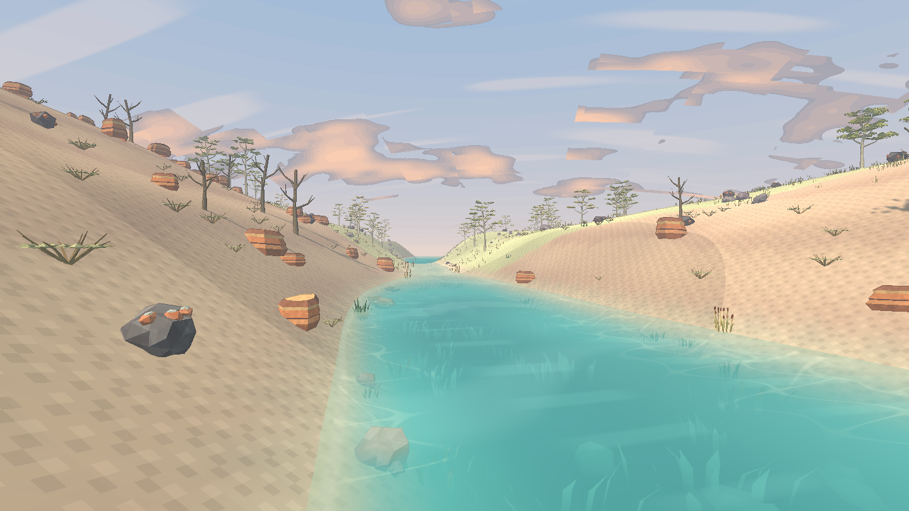
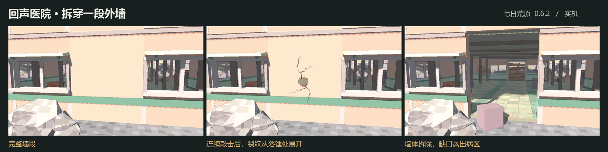
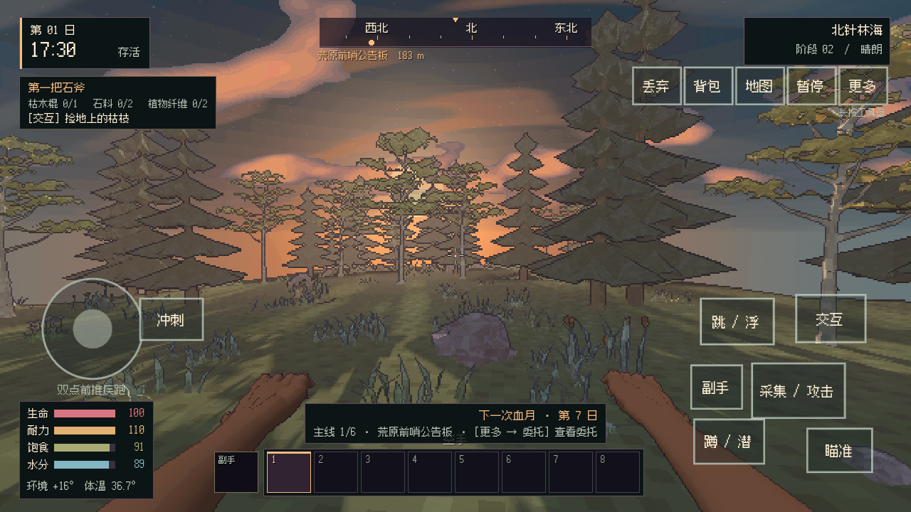

<h1 align="center">七日荒原</h1>

  
  
  

<i>7 Days to Wasteland</i> · 开放世界生存 · 单人 / 双人局域网

<h2 align="center">下载游戏</h2>

  
  &nbsp;
  

<a href="https://github.com/kunkunkunQoQ/7DaysToWasteland/releases/tag/v0.6.5">查看 0.6.5 更新说明</a>

从七位幸存者中选一位，空手在荒野落脚。第一天要找的是木棍、碎石和干净的水。到了第七天，你要考虑的是哪面墙最先被攻破，以及队友能从哪里撤回来。守过血月、找回信标记录，就能完成主线。通关后，营地和整片荒原都可以继续游玩。

## 从第一把石斧到第七夜

1. **先做一把石斧。** 拾起 **1 根木棍、2 块石头**，打草取得 **2 份植物纤维**，打开制作页即可随身合成。空手也能砍树，每拳会损失生命。用斧时留意树干上的缺口，听见木芯开裂就向侧面让开，倒下的树会砸到附近的人和生物。
2. **天黑前解决饮水和落脚点。** 把生水带回营火煮沸，或用手压泵和纤维过滤。废屋可以就地改成营地，封墙前先绕一圈看看哪里有窗洞和塌口。木框搭好后可以逐级加固，受损的构件也能修复。
3. **去驻地公告板接委托。** 完成「储水计划」后会开放中继巡线。沿途可能要清点补给箱、修理线路，或留在电台旁守听。把目的地标在罗盘上，回来时顺路带一批工坊材料。
4. **守住第七夜。** 默认第七天 **21:30** 预警，**22:00** 尸潮开始，次日 **04:00** 停止增援。木刺和铁丝网适合守住狭窄入口，波次之间可以补墙。守夜失利后，公告板还有补建防线的任务，可以继续推进主线。

## 去哪里探索

相同种子会重现地形和废墟。房屋的破口、家具和宝箱位置也随种子生成。不同地区值得带上的装备、能找到的补给各不相同。

| 地点 | 值得做的事 |
| --- | --- |
| 霜脊雪山 | 沿避风棚和缓坡登上测候站。工兵铲可以收集积雪，带回营火融成净水。 |
| 流金沙海 | 顺着干渠找驼站提水泵。缺水时留意仙人掌上的红果，以及带水嘴的蓄水箱。 |
| 灰湾水下遗迹 | 潜入沉没的渡船、断桥和泵站打捞补给。水下手记里还能记录泽龟和溪螯虾。 |
| 旧镇废墟 | 从窗洞进入医院、警局或机修车间，也能用工具打穿墙面。先看清梁柱，拆掉承重处可能把头顶的屋面一起带下来。 |

| 峡谷水岸 | 医院拆墙实机 |
| :---: | :---: |
|  |  |

## 在荒原安个家

**林地可以自己种。** 阵风、斧击和倒树都会抖落枝叶，走近时有机会捡到同种树苗。把树苗放进主手，在干燥缓地上种下，树干之间留出 3 米。白桦只需 2.5 个游戏日成熟，积雪冷杉要 5 天。外出远征时树龄照常推进，回营后可以接着砍伐。

**物资能一路用到后期。** 落叶加木棍能扎成引火束，配布和纤维能做遮阳斗篷，到化学实验台还能制成燃料。背包里的「材料用途」会列出配方和所需工作站。出门时可以一手拿斧、一手举盾，也可以腾出副手提灯探路。

**留意生物的动作。** 晨昏能看到鹿群下水饮水，夜间有灰狼追猎。感染者的衣着、装备和肢体残缺程度各不相同，腿部重损的个体会伏地拖行。喜欢收集的玩家还可以翻图鉴、解锁隐藏成就，把猫耳、充气锤或咸鱼拖鞋带回营地。

## 安装与联机

- **Windows x64**　下载页首的 ZIP，解压后运行 `7DaysToWasteland.exe`。需要兼容渲染时，运行同目录的 `Start-Compatibility.cmd`。
- **Android**　安装 APK 后横屏游玩，需要 Android 7.0 或更高版本并支持 OpenGL ES 3.0。双点移动摇杆，第二次向前推住即可疾跑。触控大小和左右手布局可在「系统设置 → 操控」调整。
- **双人局域网**　两台设备连接同一局域网并使用相同版本。房主在单人存档的暂停菜单里开放世界，队友从「附近的世界」加入，也可以手动输入局域网地址。进度由房主存回原存档，下次可以单人继续。
- **从源码运行**　用 Godot 4.6.3 标准版导入根目录的 `project.godot`，按 **F5** 启动。物品、配方与委托在 [data](data)，游戏逻辑在 [game](game)，回归检查在 [tools](tools)。

## 开源许可

《七日荒原》采用 **GNU 通用公共许可证第 3 版**（`GPL-3.0-only`）。[查看许可全文](LICENSE)

随项目分发的缝合像素字体及其上游组件沿用 **SIL Open Font License 1.1**。[字体许可](assets/FusionPixel-OFL.txt) · [上游版权与许可](assets/FusionPixel-LICENSE.txt)
