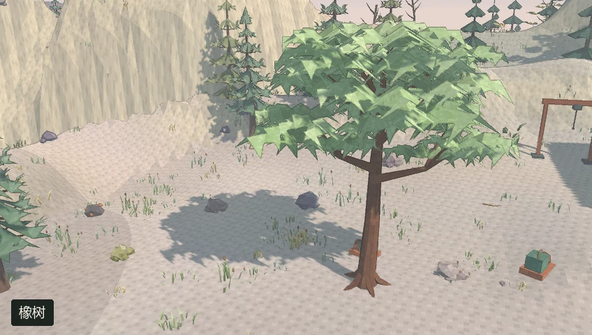
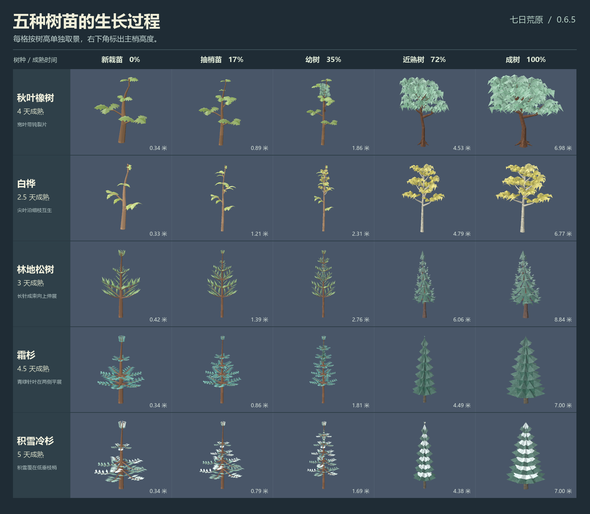

<h1 align="center">七日荒原</h1>

<i>7 Days to Wasteland</i> · 开放世界生存 · 单人 / 双人局域网

  <a href="https://github.com/kunkunkunQoQ/7DaysToWasteland/releases/download/v0.6.5/7DaysToWasteland-Windows-x64.zip"><strong>下载 Windows x64 版</strong></a>　·　
  <a href="https://github.com/kunkunkunQoQ/7DaysToWasteland/releases/download/v0.6.5/7DaysToWasteland.apk"><strong>下载安卓 APK</strong></a>　·　
  <a href="https://github.com/kunkunkunQoQ/7DaysToWasteland/releases/tag/v0.6.5">0.6.5 更新说明</a>

你空手醒在荒野。捡落枝和碎石、打草取纤维，做出第一把石斧。天黑前找水、生火，在废墟里选个能守住的落脚点。到了第七夜，尸潮会来试试你的墙够不够结实。

## 荒原里有什么

- **雪山、沙海和水下遗迹**　沿雪线找测候站，顺着干渠去驼站取水，或潜进沉没的泵站打捞补给。
- **会倒的树，会塌的房**　从树干一侧下斧可以控制倒向，落叶里偶尔能捡到同种树苗。拆开废屋的墙能抄近路，拆掉承重柱也可能让屋顶落下来。
- **能通关的双人生存**　在公告板接委托，和队友守过血月，把信标记录带回驻地。通关后仍可回到原世界建设和探索。

## 开始游玩

**Windows** 解压后运行 `7DaysToWasteland.exe`。**安卓** 安装 APK 后横屏游玩，需要 Android 7.0 或更高版本并支持 OpenGL ES 3.0。

**局域网联机**　房主在单人存档的暂停菜单开放世界，队友连接同一局域网，用相同游戏版本从「附近的世界」加入。

<strong>展开实机截图</strong> · 峡谷、触屏、拆墙与树苗

| 峡谷水岸 | 安卓触屏求生 |
| :---: | :---: |
|  |  |
| **医院墙体拆除** | **五种树苗的生长过程** |
|  |  |

从源码运行时，用 **Godot 4.6.3 标准版**导入 `project.godot`，按 **F5** 启动。
